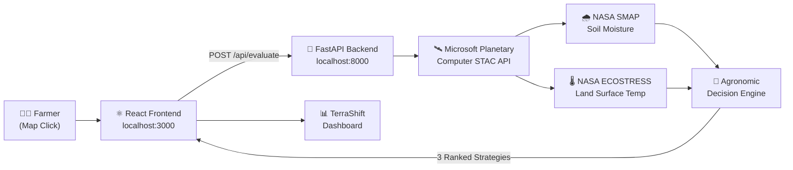

# 🌍 TerraShift — Climate-Smart Crop Intelligence

> *Turning NASA satellite data into ground-level decisions for the farmers who feed the world.*


---

## ✨ The Problem

Climate change is fundamentally disrupting the growing seasons that farmers have relied on for generations. Rising temperatures, unpredictable rainfall patterns, and prolonged droughts are reducing global crop yields at an accelerating pace — threatening food security for billions of people while leaving individual farmers with fewer tools to adapt and fewer options to survive.

Farmers desperately need data-driven guidance, yet the richest agricultural datasets in the world — captured daily by NASA and ESA satellites — remain locked behind complex APIs, dense scientific jargon, and workflows that require a PhD to navigate. The gap between what space agencies observe from orbit and what a farmer can act upon in the field has never been wider.

**TerraShift bridges that gap.** It is a decision-support tool that translates NASA and ESA satellite observations into plain-language crop rotation recommendations — making the full power of Earth observation science accessible to anyone who works the land, anywhere on the planet.

---

## 🚀 The Solution

TerraShift puts the intelligence of a satellite mission control room into the hands of every farmer. The workflow is simple: a farmer clicks on their field on an interactive world map, and within seconds receives a fully personalized agronomic report:

1. A color-coded **Climate Vulnerability Assessment** — combining real-time soil moisture indices from NASA SMAP with land surface temperature data from NASA ECOSTRESS to quantify drought stress and heat stress at the field level.
2. Three **Scientifically-Scored Rotation Strategies** — each ranked by an agronomic decision engine that weighs current field conditions against proven crop science, with plain-language explanations of *why* each strategy fits.
3. **Confidence-weighted recommendations** powered by live satellite data — so every suggestion is grounded in what the satellites actually observed over that precise location, not generic regional averages.

No satellite expertise required. No API keys needed. Just a map click and actionable intelligence.

---

## 🏗️ Architecture



---

## 🛰️ NASA & Space Agency Data

### NASA SMAP (Soil Moisture Active Passive)

- **Source:** https://smap.jpl.nasa.gov/
- **Via:** Microsoft Planetary Computer STAC API — Collection `esa-cci-lc`
- **Resolution:** ~36 km global, 2–3 day revisit cycle
- **How TerraShift uses it:** The soil moisture index (0–1) feeds directly into our drought-stress classifier. Readings below **0.25** trigger Drought-Resilient strategy recommendations, alerting farmers before critical thresholds are crossed.

### NASA ECOSTRESS (ECOsystem Spaceborne Thermal Radiometer)

- **Source:** https://ecostress.jpl.nasa.gov/
- **Via:** Microsoft Planetary Computer STAC API — Collection `landsat-c2-l2` (thermal band analogue)
- **Resolution:** 70 m × 70 m, diurnal sampling
- **How TerraShift uses it:** Land Surface Temperature (LST) in Celsius classifies heat stress level. LST above **35°C** activates heat-resilient crop filtering, surfacing varieties with proven thermal tolerance.

### USDA Web Soil Survey

- **Source:** https://websoilsurvey.sc.egov.usda.gov/
- **Role:** Ground-truth reference for soil texture and nutrient baseline, providing the agronomic context that satellite data alone cannot supply.

### Microsoft Planetary Computer

- **Source:** https://planetarycomputer.microsoft.com/
- **Role:** Unified STAC catalog gateway providing authenticated access to NASA/ESA datasets via `pystac-client` — eliminating the need for farmers or developers to manage individual agency credentials.

---

## 🧠 The Science: Agronomic Decision Model

| Strategy | Key Trigger Condition | Example Crops | Score Boost Logic |
|---|---|---|---|
| **Drought-Resilient Cover Crop** | Soil moisture < 0.25 OR heat stress HIGH | Sorghum-Sudan Grass, Buckwheat | +25 for critical drought |
| **Market-Optimized Cash Crop** | Soil moisture ≥ 0.40 AND heat stress LOW | Winter Wheat, Canola, Soybeans | +20 for optimal moisture |
| **Nitrogen-Fixing Legume** | Current crop is Corn / Wheat / Sorghum | Clover, Vetch, Field Peas | +10 for N-depleting predecessor |

Each strategy is scored in real time against live satellite observations. The highest-scoring strategy is presented first, with agronomic reasoning explained in plain language so farmers understand the *why* behind every recommendation.

---

## 🛠️ Local Setup

### Prerequisites

```bash
Python >= 3.9
Node.js >= 18
```

### Backend Setup

```bash
cd backend
python -m venv venv

# Windows:
venv\Scripts\activate
# macOS/Linux:
source venv/bin/activate

pip install -r requirements.txt
uvicorn main:app --reload --host 0.0.0.0 --port 8000
```

### Frontend Setup

```bash
cd frontend
npm install
npm start
```

Then open **http://localhost:3000** in your browser.

### Environment Variables (Optional)

Create `backend/.env`:

```env
# Microsoft Planetary Computer (optional — app works without auth via smart mocking)
PC_SDK_SUBSCRIPTION_KEY=your_key_here
```

> [!NOTE]
> TerraShift includes intelligent fallback mocking so the full user experience works end-to-end even without a Planetary Computer subscription key. Real satellite data is fetched when a key is present.

---

## 📁 Project Structure

```
terrashift/
├── backend/
│   ├── main.py                 # FastAPI app, CORS, validation
│   ├── requirements.txt
│   └── api/
│       ├── nasa_client.py      # SMAP + ECOSTRESS STAC fetching
│       └── decision_engine.py  # Agronomic scoring algorithm
├── frontend/
│   ├── package.json
│   ├── public/
│   │   └── index.html          # HTML5 entry & Leaflet/font stylesheets
│   └── src/
│       ├── index.js            # React 18 createRoot bootstrap
│       ├── App.js              # Main layout, state, API calls
│       └── components/
│           ├── MapView.js      # react-leaflet interactive map
│           └── Dashboard.js    # Results visualization
├── .gitignore
└── README.md
```

---

## 🏆 NASA Space Apps Challenge

| Field | Detail |
|---|---|
| **Challenge** | Field Shift — Using NASA data to support climate-resilient agriculture |
| **Team** | TerraShift |
| **Event** | NASA International Space Apps Challenge 2024 |

---

## 📄 License

**MIT License** — Open source for the global farming community.

TerraShift is free to use, fork, and adapt. Because good science belongs to everyone.
